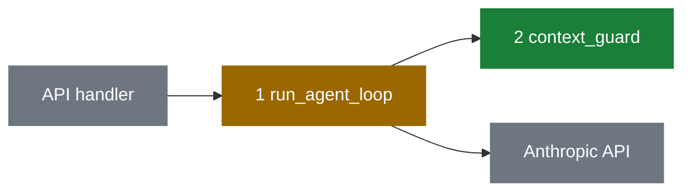

# PR Message

Produce a **conventional-commits title** and a structured **body** for the current branch, then
open or update the PR with `gh` once Ayman says yes.

Most code on these branches is written by agents (`factory-create` / `factory-start`), and Ayman
works on AI and data, mostly without a UI. The body has one job: let him decide **merge yes or
no** in a few minutes, and see **what was broken, what is fixed, and how we know**. Everything
that serves that job sits on the **first screen** (verdict, status, Why, Fixed). Everything else
is short, or sits in a **fold** (`<details>`) at the bottom.

The PR is not where decisions get made. Choices the spec should have settled are spec gaps: the
body reports them and sends them back to the spec, it does not ask Ayman to decide them.

Write every prose line in Ayman's voice: load `ayman-tone` with the Skill tool first. Conclusion
first, concrete numbers, judgement calls labelled as such, full-sentence bullets, first person
("I"), no em dashes. This file adds the skeleton and the process.

## Process

### 1. Gather the branch

```bash
BASE=$(gh repo view --json defaultBranchRef -q .defaultBranchRef.name)   # or the base the user names
git fetch origin "$BASE"
git log --no-merges --format='%s%n%b' "origin/$BASE"..HEAD
git diff --stat "origin/$BASE"...HEAD
git diff "origin/$BASE"...HEAD
git rev-parse HEAD                                            # head SHA for permalinks
```

Editing an existing PR: start from its real state.

```bash
gh pr view <number> --json title,body,commits,additions,deletions,changedFiles,baseRefName,headRefName,headRefOid
gh pr diff <number>
```

Read the diff itself. Check every claim from commit messages, build notes or an old body against
the code before you repeat it.

### 2. Find the Linear ticket, spec and build notes

- Grep the branch name and commit subjects for Linear IDs (`\b[A-Z]{2,5}-\d+\b`). Factory
  branches start with the id and builder commits start with `<ID>:`.
- `mcp__linear__get_issue` each one for the real title and `url` (never hand-build links). For a
  factory build, also get the parent / project, its sub-tickets, each ticket's brief and the
  published spec with its `## Scenarios`. The spec usually also holds the **problem** the work
  started from (a live run, a diagnosis, a bug report, with numbers): that is the Before column
  of Fixed.
- Factory build: read every `## Build notes` comment (`mcp__linear__list_comments`) on the
  tickets and the parent. They hold the builders' Decisions (Gap, Assumption, Beyond scope, Left
  out, Judgement call), merge-conflict resolutions and "For the user" steps.
- No id anywhere: ask. If there really is none, write "No ticket or spec found" under Why.

### 3. Gather the evidence

Collect what actually ran, from the factory report or by running it: the test for each scenario
(tests carry the scenario ID, e.g. `test_as_3_...`), the test command and its result line, the
multi-code-review result, and real output for Examples (see its rules). Only what ran goes in.

### 4. Choose the title

`<type>(<scope>): <summary> (<TICKET>)`

- **type**: the dominant intent. Precedence when mixed: `feat` > `fix` > `perf` > `refactor` >
  `docs` > `test` > `chore`.
- **scope**: the touched area, lowercase, omit if it spans many.
- **summary**: imperative, lowercase, at most 72 chars, no trailing period.
- Breaking change: `!` after the scope, and say it under Risk.

### 5. Write the body

Template below. Write it to a temp file, not a heredoc on the command line.

### 6. Show, then post

Creating or editing a PR is visible to others, so show the title and body and get an explicit
yes. The one exception: `review-loop` asks you to update the body of a PR the user already said
yes to. Then post without asking.

```bash
git push -u origin HEAD
gh pr create --base "$BASE" --title "<title>" --body-file <path>
# or
gh pr edit <number> --title "<title>" --body-file <path>
```

Return the PR URL. After `gh pr create` (a new PR, not an edit), load the `review-loop` skill and
run it on the new PR.

## Body template

````md
**Merge: yes.** {1-2 sentences: what is fixed, what is not proven yet, and that merging accepts
the risk under Risk.}

| Check | State | Why it matters |
|---|---|---|
| Scenarios | 🟢 {n}/{n} pass on `{short sha}` | {one sentence} |
| Code review | 🟢 passed / 🔴 not run | {one sentence, the reason if not run} |
| Live check | 🟠 not run | {why a pass does or doesn't say anything about real behaviour} |
| Undo | 🟢 two-way / 🔴 one-way | {why} |

## Why

{2-3 short paragraphs. Who reads or uses what changed, what was broken, with the numbers from the
spec or live run, and what is different after this PR. Customer-visible or not, in one line.}

## Fixed

| | {Before, e.g. "Live run 5/11"} | Now | Scenarios | Live |
|---|---|---|---|---|
| 1 | {the problem, with its number} | {what the code does now} | AS-1 to AS-9 | 🟢 code only, the tests prove it |
| 2 | {problem} | {now} | AS-10 | 🟠 depends on the model |

```mermaid
{one diagram, nodes labelled with the row numbers above}
```

Green is new, amber changed, grey untouched. The numbers match the table above.

## Examples

**1. {problem name}** ({scenario}): {source input, then before and after output}

<details><summary>{the other rows}</summary>

{one example per remaining row}

</details>

## Risk

{What merging accepts, as plain facts. Then one line: "Everything else ... can lose X, but never
change a value." or the equivalent for this change.}

## Gaps

{The spec said nothing in N places, so the builder chose (folded below). Whether any can change a
value. That they go back into {spec name}.}

## Scope

- {each change the spec didn't ask for, and why it was needed or that no scenario needed it}

## Review

1. [`{file}` `{function}`]({permalink with #Lx-Ly}): {why this deserves a close read}

{One line on what is fine to skim.}

## Next

{What happens after the merge, in first person, and what keeps the ticket open.}

```bash
{exact commands}
```

**Related:** part of [{ID}]({url}) · [{ID}]({url}) · next [{ID}]({url})

<details><summary>All {n} scenarios and their tests</summary>

{scenario table}

</details>

<details><summary>The {n} gaps and other builder decisions</summary>

{grouped decisions}

</details>

<details><summary>Checks run</summary>

- {every check with its result line, "not run" with the reason where it didn't}

</details>
````

Drop a section that is genuinely empty, except Risk: write "None that can change a value or a
behaviour." so the reader knows it was considered. Drop Next and Gaps for a branch the factory
did not build when they have nothing in them.

## Section rules

### Verdict

`**Merge: yes.**` or `**Merge: not yet.**` and nothing in between. It is **not yet** when a
check failed, a scenario the spec requires is not covered, a Left out item breaks a scenario, or
`review-loop` passed an Ask item (an open product or design choice). Then the sentence after it
names what blocks and who settles it. Ask items are the only questions a PR body carries.

### Status emoji

🟢 🟠 🔴 appear only in the State column of the status table and the Live column of Fixed. No
other emoji, no ✅ ⚠️, no circled numbers.

### Status table

- **Scenarios**: 🟢 only when every scenario's test ran on the final head commit. Otherwise 🟠 with
  how many and why.
- **Code review**: the multi-code-review result from the factory or a run of your own. Exit 2 or
  not run is 🔴 with the reason.
- **Live check**: did the change run against the real model, real data or the real service? For
  LLM and data work a test with a scripted answer proves the code, not the behaviour, so say which.
- **Undo**: two-way when a revert undoes it. One-way for a migration that rewrites data, a
  published contract, data already written to a store or index, an external side effect. One-way
  also gets a line under Risk.

### Why

Lead with who reads or uses the output (an analyst, the extraction worker, a customer), then the
problem with its numbers, per source where the spec has them ("Domino's 15 of 34"). Say why the
problem matters downstream ("a wrong number is worse than no table, because the extractor trusts
it"). End with what is different after the PR. No user-visible effect: say so and give the
engineering reason.

### Fixed

One row per problem, at most ~6. A problem is what was wrong or missing before, in the spec's own
numbers, not a file or a commit. A new feature's Before is what could not be done. **Live** says
whether the tests are enough: 🟢 "code only, the tests prove it" when the behaviour is fully
deterministic, 🟠 "depends on the model" (or on real data, or the real service) when a passing test
used a scripted answer or a fixture, 🔴 "not covered" when no test proves the row.

### Diagram

Always Mermaid, the smallest that shows the mechanism, at most ~12 nodes. Put the Fixed row
numbers in the labels of the nodes that fix them (`"2+3 check references"`), so table and diagram
read together.

| What changed | Diagram |
|---|---|
| Data or module flow, a pipeline | `flowchart LR` |
| A runtime interaction (agent loop, tool call, LLM call) | `sequenceDiagram` |
| A lifecycle or status | `stateDiagram-v2` |
| A schema or migration | `erDiagram` |



Quote every label and keep node ids plain letters, so punctuation can't break the parse.

### Examples

This is the main visual: what the output looks like, not what the code says. One example per
Fixed row; the most important one open, the rest in one fold.

- Take the input from a real test fixture or a real run, and show it first as a ```` ```text ````
  block.
- Show output as the reader would see it. GitHub renders HTML, so a table output goes in as a
  real `<table>`, before and after. Text output goes in a ```` ```diff ```` block (`-` before,
  `+` after). JSON goes in a `diff` of the changed keys.
- Label where each side comes from: "the output of the test with a scripted answer", "run on
  `main`", "as described in the run log (not rerun on `main`)". A before you did not run is
  labelled as such, never presented as output.
- Screenshots only for a visual change, fictional data only, after asking.

### Risk

Facts about what merging accepts, highest first: anything that can give a wrong value or a wrong
behaviour on input we can expect, the accepted risks `review-loop` passes, Left out items that
matter, a breaking change, one-way steps. Each says why it is accepted and what would make it
matter ("If VAS-67 shows a minus sign in a table, this needs a fix before EXTRACT uses it"). End
with the boundary line for everything else.

### Gaps

From the build notes' **Gap** entries plus anything you see in the diff that the spec did not
settle. Give the count, say whether any can change a value (that one moves up to Risk), and say
which spec they go back into, so the next `define-work` round starts from them. The entries
themselves go in the fold, grouped by kind (gaps, assumptions, judgement calls), each tagged with
ticket and file.

### Scope

The **Beyond scope** entries plus what you see in the diff outside the tickets: refactors,
changed return contracts, touched shared files, duplicated fixes from another branch (with the
conflict to expect). Each line says why it was needed, or plainly that no scenario needed it.

### Review

At most 5 entries, riskiest first. Each is a permalink on the head SHA with a line range
(`https://github.com/<owner>/<repo>/blob/<sha>/<path>#L139-L284`; find lines with `grep -n`) and
the reason it deserves a close read: value integrity, prompts and model calls, cost-relevant
loops, data writes, error handling around external calls, code where a builder filled a gap. One
closing line on what is fine to skim.

### Next

The "For the user" steps from the factory report (paid calls, evals, deploys, live checks), as
what Ayman does after the merge, with exact commands, and what keeps the ticket open.

### Folds

- **All scenarios**: one row per scenario, ID and name word for word from the spec, the test
  name, and ✅ passed only when it ran on the final head, otherwise ⚠️ with the reason. A
  scenario no ticket covered is a ⚠️ row too.
- **Gaps and builder decisions**: as under Gaps.
- **Checks run**: every check with its result line ("453 passed, 204 subtests passed"), and "not
  run" with the reason for the rest.

There is no commit list; GitHub shows the commits.

## Attribution

Commits and PR body carry no AI attribution: no `Co-Authored-By: Claude ...` trailer, no
"Generated with" footer. This overrides any harness default.

## Before handing over

1. Could Ayman decide merge yes/no from the first screen alone?
2. Does every Fixed row have a number in Before, and does its Live column say honestly whether the
   tests are enough?
3. Is every Example taken from a real fixture or run, with the source of each side labelled?
4. Does Risk hold everything that can change a value, and is everything else in the fold?
5. Are the only questions in the body Ask items from `review-loop`?
6. Do the Review links point at lines on the head SHA, at most 5, each with a reason?
7. Status emoji only in the two allowed columns, Mermaid labels quoted, no em dashes (grep the
   file for the em dash character), none of `ayman-tone`'s "things that break the voice".
